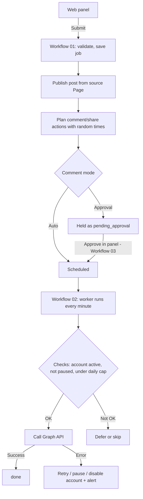

# Facebook Multi-Page Automation (n8n)

A self-hosted automation system built on **n8n + PostgreSQL** for managing several Facebook **Pages** from one web panel. Publish a post from one Page, and the other selected Pages can **comment on it or share its link** later, at randomized times, with an optional human approval step.

> **Status:** workflows are built and validated for structure and syntax. Live testing with real Page tokens is still in progress. Test on 2-3 of your own Pages first.

---

## What it does

- **Web control panel:** pick the posting Page, pick which Pages react, choose post type (text / photo / video), caption, time gaps, comment mode, and comment language.
- **Publishes via the Graph API** using each Page's own token.
- **Staggered actions:** every reacting Page gets its own random delay (for example Page B after 14 min, Page C after 41 min).
- **Context-aware comments:** text depends on the post topic (food, travel, celebration, motivation, video, photo) and the chosen language (English, Roman Urdu, or a mix). Comments within one job never repeat.
- **Approval mode (default):** comments are held until you preview and approve them. Auto and Off modes are also available.
- **Safety and error handling:** daily caps, automatic account pause on rate limits, retries with backoff, token health checks, kill switch, and alerts.
- **One set of workflows for all accounts.** Pages are just rows in a database table.

---

## How it works



---

## Repository structure

```
fb-multi-page-automation/
├── workflow/
│   ├── 01_FB_Panel_Publish_Plan.json   # panel, publish, action planning
│   ├── 02_FB_Action_Worker.json        # executes due actions, token checks
│   ├── 03_FB_Job_Control.json          # approve, cancel, status, kill switch
│   └── 04_FB_Error_Alert.json          # sends alerts when a workflow fails
├── sql/
│   └── setup.sql                       # database schema
├── docker-compose.example.yml          # PostgreSQL for the app data
├── .env.example                        # database settings template
├── .gitignore
└── README.md
```

### The four workflows

| # | Workflow | Role |
|---|----------|------|
| 01 | Panel, Publish & Plan | Serves the web panel (`/webhook/fb-panel`), validates input, publishes the post, and creates the comment/share actions. |
| 02 | Action Worker | Runs every minute. Claims due actions, checks limits, calls Facebook, handles errors. Also checks tokens every 6 hours. |
| 03 | Job Control | Endpoints behind the panel buttons: status, preview, approve, cancel, kill switch, edit comment. |
| 04 | Error Alert | Set as the Error Workflow for 01 and 02. Sends a message to your alert webhook. |

---

## Requirements

- Docker Desktop (or any Docker host)
- n8n (self-hosted)
- PostgreSQL 16 (the compose file provides one)
- A Meta developer app with the Pages permissions
- Admin access to every Facebook Page you connect

---

## Setup

### 1. Database

```bash
cp .env.example .env            # then edit the values
docker compose -f docker-compose.example.yml --env-file .env up -d
```

Create the tables, then set your panel key:

```bash
docker exec -i fbdb psql -U fb -d fbauto < sql/setup.sql
docker exec fbdb psql -U fb -d fbauto -c "UPDATE fb_settings SET v='YOUR_LONG_RANDOM_KEY' WHERE k='panel_key';"
```

### 2. Meta app and Page tokens

1. Create an app at `developers.facebook.com` and add the Pages use case.
2. In Graph API Explorer, generate a user token with: `pages_show_list`, `pages_manage_posts`, `pages_manage_engagement`, `pages_read_engagement`.
3. Exchange it for a long-lived token, then list your Pages with `GET /me/accounts`.
4. Each Page returns an `id` and an `access_token`.

### 3. Add Pages to the database

```bash
docker exec fbdb psql -U fb -d fbauto -c "INSERT INTO fb_accounts (name,page_id,access_token,daily_cap) VALUES ('Page A','PAGE_ID','PAGE_TOKEN',20);"
```

Never commit tokens to Git.

### 4. n8n

1. Create a **Postgres credential** in n8n (host `host.docker.internal`, port `5433`, database `fbauto`, matching user and password, SSL disabled).
2. Import the four JSON files from `workflow/`.
3. Assign the Postgres credential to every Postgres node.
4. In workflows 01 and 02: **Settings, Error Workflow**, select `FB Multi 4 - Error Alert`.
5. **Publish** all four workflows.
6. If the panel buttons do nothing, start n8n with `N8N_INSECURE_DISABLE_WEBHOOK_IFRAME_SANDBOX=true`.

### 5. Open the panel

```
http://localhost:5678/webhook/fb-panel
```

Use the production URL (`/webhook/`), not `/webhook-test/`.

---

## Using the panel

1. Enter your panel key and click **Accounts load karein**.
2. Choose the **source Page**, the **reacting Pages**, post type, caption, and media URL (public https, for photo and video).
3. Set the minimum and maximum gap in minutes.
4. Choose the comment mode and language, and optionally enable link sharing.
5. Click **Publish + Schedule**. You get a Job ID.
6. Under **Job Control**: preview the comments, approve, check status, cancel the job, or hit the kill switch.

### Comment modes

| Mode | Behavior |
|------|----------|
| Approval (default) | Comments wait until you approve them. Timings shift forward if you approve late. |
| Auto | Comments are scheduled immediately. |
| Off | No comments. Sharing can still be enabled. |

---

## Error handling

| Situation | What happens |
|-----------|--------------|
| Token invalid or expired (code 190/102) | Account is disabled, action fails, alert sent |
| Rate limit (4, 17, 32, 613) | Account paused 60 min, action retried |
| Action blocked (368) | Account paused 24 h, alert sent |
| Network error or 5xx | Retried with backoff, up to 4 attempts |
| Permission or invalid object (10, 200, 100) | Action marked failed, alert sent |
| Daily cap reached | Action deferred by 60 min |
| Worker crashes mid-action | Stuck actions return to the queue after 10 min |
| Duplicate submit within 10 min | Rejected |
| Any workflow crash | Error workflow sends an alert |

Alerts go to the URL stored in `fb_settings` under `alert_url` (Slack, Discord, or any webhook).

---

## Database tables

| Table | Purpose |
|-------|---------|
| `fb_settings` | `panel_key` and `alert_url` |
| `fb_accounts` | Pages: id, name, token, active flag, daily cap, pause time, token status |
| `fb_jobs` | Each post request: source Page, targets, content, mode, status, permalink |
| `fb_actions` | Each comment or share: account, text, run time, status, attempts, last error |

---

## Important notes

- **Pages only.** Facebook's API does not allow posting or commenting on personal profiles.
- **"Share" posts the link** of the original post as a new Page post. It is not a native reshare.
- **Meta policy:** coordinated comments between accounts you control can violate Meta's platform policy on inauthentic behavior. Keep Approval mode on, use realistic caps, and review Meta's current policy before using this with real audiences.
- **Other people's Pages** need Meta App Review and Business Verification, plus an OAuth connect flow (not included yet).
- Tokens are stored in plain text in the database. For production, encrypt them and restrict database access.
- Always use HTTPS in production and a long panel key.

---

## Troubleshooting

| Problem | Likely cause and fix |
|---------|----------------------|
| "Koi account nahi mila" | Wrong panel key, no accounts, or accounts set to `active=false` |
| 404 on the panel URL | Workflow 01 is not published, or you used `/webhook-test/` |
| Publish refused in n8n | A Postgres node is missing its credential |
| Publish fails with code 200 or 10 | Missing page permissions, regenerate the token |
| Code 190 | Token expired, add a new one and set `active=true` |
| Photo or video not posted | Media URL must be public https |
| Comments never run | Workflow 02 not published, or the job was not approved |

---

## Roadmap

- OAuth flow so customers can connect their own Pages
- Encrypted token storage
- Webhook trigger: react automatically when a Page posts
- Multi-customer support (`customer_id`)
- Update Graph API version across all nodes

---

## License

Add a license of your choice before making this repository public.