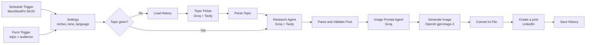

# 💼 LinkedIn Post Automation: AI Research, Write, Design & Publish Agent

> **n8n + Groq + Tavily + OpenAI Images + LinkedIn.** An agent that researches a topic on the live web, writes a LinkedIn post, designs a matching graphic, and publishes both. It runs fully automatically on a schedule, or on demand from a form.

---

## ✨ What this agent can do

| Capability | Status |
|---|---:|
| Scheduled auto-posting (default Mon / Wed / Fri, 09:00) | ✅ |
| Manual posts from a web form (topic + audience) | ✅ |
| Picks a fresh, trending topic by itself when none is given | ✅ |
| Remembers recent topics to avoid repeats | ✅ |
| Live web research with Tavily (real stats, sources, current date aware) | ✅ |
| Post structure: hook, context, insights, takeaway, CTA, hashtags | ✅ |
| Source attribution inside the post | ✅ |
| Automatic quality gate (length, hashtags, placeholder text) | ✅ |
| Marketing-style graphic prompt written for each post | ✅ |
| Image generation and publishing with the post via the LinkedIn API | ✅ |
| Any language / tone / audience | ✅ |
| Human review step before publishing | ➕ optional (see [Customization](#-customization)) |

---

## 🧠 Architecture



---

## 📁 Folder contents

```text
linkedin-post-automation/
├── README.md
├── .env.example
├── .gitignore
├── docker-compose.example.yml
├── workflow/
│   └── linkedin-post-agent.json     # Import this into n8n
└── prompts/
    ├── topic-picker.txt             # Reference copy of the Topic Picker system prompt
    ├── research-agent.txt           # Reference copy of the Research Agent system prompt
    └── image-agent.txt              # Reference copy of the image prompt agent system prompt
```

> The workflow JSON is a **sanitized, portable build**. It contains no API keys and no credential IDs. You connect your own credentials after importing.
> The files in `prompts/` are reference copies. The live prompts are inside the workflow nodes.

---

## 📥 Download

**Option A: clone the whole repo (recommended)**

```bash
git clone https://github.com/saadfaisal65/Automation-Agents.git
cd Automation-Agents/linkedin-post-automation
```

**Option B: download a ZIP**

1. Open <https://github.com/saadfaisal65/Automation-Agents>
2. Click **Code → Download ZIP** and extract it.
3. Open the `linkedin-post-automation` folder.

**Option C: only the workflow file**

```bash
curl -L -o linkedin-post-agent.json \
  https://raw.githubusercontent.com/saadfaisal65/Automation-Agents/main/linkedin-post-automation/workflow/linkedin-post-agent.json
```

---

## ✅ Accounts you need

| Service | Used for | Get a key |
|---|---|---|
| **n8n** | Runs the workflow (self-hosted Docker, `npx`, or n8n Cloud) | <https://n8n.io> |
| **Groq** | The LLM (`openai/gpt-oss-120b`) behind all three agents. The free tier is rate-limited | <https://console.groq.com/keys> |
| **Tavily** | Live web search for research | <https://app.tavily.com> |
| **OpenAI** | Image generation (`gpt-image-2`). Needs an API account with billing | <https://platform.openai.com/api-keys> |
| **LinkedIn Developer App** | Posting to your profile through the official API | <https://www.linkedin.com/developers/apps/new> |

---

# 🚀 Start-to-finish setup

## 1) Run n8n

If n8n is already running, skip to **Step 2**. If you already run n8n from another folder in this repo, reuse that instance. You do not need a second container.

### Option A: Docker (recommended)

```bash
cd linkedin-post-automation
cp .env.example .env
cp docker-compose.example.yml docker-compose.yml
```

Edit `.env`:

```env
TZ=Asia/Karachi
GENERIC_TIMEZONE=Asia/Karachi
N8N_ENCRYPTION_KEY=PASTE_A_LONG_RANDOM_SECRET
```

Generate the secret with `openssl rand -hex 32`, and keep a backup of it.

Start n8n and open <http://localhost:5678>:

```bash
docker compose up -d
```

Create your owner account on first launch.

### Option B: quick start without Docker

```bash
npx n8n
```

This needs a recent Node.js (see the n8n docs for the supported version). Then open <http://localhost:5678>.

### Option C: n8n Cloud

Sign up at <https://n8n.io>. Everything below works the same. LinkedIn OAuth is easier there because the redirect URL is already public HTTPS.

> **Important:** the schedule only fires while n8n is running. For always-on posting, host n8n on a server or VPS, or keep the Docker container running.

---

## 2) Create your credentials in n8n

Open n8n → **Credentials → Create credential**.

### 2.1 Groq

1. Create a key at <https://console.groq.com/keys>.
2. In n8n, create a **Groq** credential and paste the key.

### 2.2 Tavily

1. Create a key at <https://app.tavily.com> (it looks like `tvly-...`).
2. In n8n, create a **Bearer Auth** credential, name it `Tavily API`, and paste the key as the token.

### 2.3 OpenAI

1. Create a key at <https://platform.openai.com/api-keys> and make sure billing is enabled.
2. In n8n, create an **OpenAI** credential and paste the key.

### 2.4 LinkedIn

1. Create a developer app at <https://www.linkedin.com/developers/apps/new>. It must be associated with a LinkedIn **Company Page** (you can create one for free).
2. In the app's **Products** tab, request:
   - **Share on LinkedIn**
   - **Sign In with LinkedIn using OpenID Connect**
3. In n8n, create a **LinkedIn OAuth2 API** credential (personal profile posting). Leave **Organization Support** off.
4. Copy the **OAuth Redirect URL** shown in the n8n credential and add it in your LinkedIn app under **Auth → Authorized redirect URLs**.
5. Copy **Client ID** and **Primary Client Secret** from the LinkedIn app's **Auth** tab into the n8n credential, then click **Connect / Sign in with LinkedIn** and approve.

> If LinkedIn rejects an `http://localhost` redirect URL, expose n8n on an HTTPS URL (for example a Cloudflare Tunnel), set `N8N_EDITOR_BASE_URL` and `WEBHOOK_URL` in `.env`, restart, and copy the new redirect URL.
> If you pick the *LinkedIn Community Management OAuth2 API* credential and get `unauthorized_scope_error` for `w_organization_social`, switch to *LinkedIn OAuth2 API* with Organization Support off.
> Posting as a company page needs LinkedIn's Community Management App Review. See the [n8n LinkedIn credentials docs](https://docs.n8n.io/integrations/builtin/credentials/linkedin).

---

## 3) Import the workflow into n8n

1. In n8n, click **Create Workflow** (or open a blank workflow).
2. Click the **⋯** menu at the top right → **Import from File…**
3. Choose `workflow/linkedin-post-agent.json`.

Alternative: open the JSON file, copy everything, click on the empty n8n canvas, and paste with `Ctrl+V` / `Cmd+V`.

You will see 18 nodes, including a yellow **Setup Notes** sticky note.

---

## 4) Connect credentials to the nodes

Some nodes will show a red warning because credentials are not selected yet. Open each node and choose yours:

| Node | Credential to select |
|---|---|
| **Groq Chat Model** | Your Groq credential |
| **Tavily** | Authentication: *Generic Credential Type* → *Bearer Auth* → `Tavily API` |
| **Generate Image** | Your OpenAI credential |
| **Create a post** | Your LinkedIn credential, then pick your profile in **Person** |

---

## 5) Configure your content

Open the **Settings** node and edit:

| Field | Meaning | Default |
|---|---|---|
| `niches` | Topics the agent may pick from in auto mode | `AI and automation, technology and business, productivity and leadership` |
| `audience` | Default audience (a form value overrides it) | `Business professionals and decision-makers` |
| `tone` | Writing tone | `Professional, confident, conversational` |
| `language` | Language of the post | `English` |

Change the schedule in **Schedule Trigger** (cron expression, default `0 9 * * 1,3,5` = Mon, Wed, Fri at 09:00). It uses the timezone from `GENERIC_TIMEZONE`, or from n8n **Workflow Settings → Timezone**.

---

## 6) Test safely (nothing gets published)

1. Right-click the **Create a post** node → **Deactivate**.
2. Click the **On form submission** node → **Execute step**. A test form opens.
3. Fill in a topic (for example `Why most AI pilot projects stall`) and an audience, then submit.
4. Watch the nodes turn green, and check:
   - **Research Agent** output (the post plus sources)
   - **Parse Post** output (`post`, `words`, `chars`)
   - **Clean Image Prompt** output
   - **Convert to File** → *Binary* tab shows the generated image
5. Run again with an **empty topic** to test the auto-pick path (Topic Picker).
6. Re-activate **Create a post** (right-click → **Activate**).

To test the LinkedIn step once, execute **Create a post** and check your profile.

---

## 7) Go live

1. Click the **Active** toggle at the top right of the workflow.
2. The schedule now posts automatically.
3. Manual posts: open **On form submission** → **Production URL** and bookmark the form.

> Topic history (used to avoid repeats) is only saved in **production** runs, not in test runs.

---

# ⚙️ Customization

| I want to change... | Where |
|---|---|
| Niches, tone, language | **Settings** node |
| Posting days and time | **Schedule Trigger** cron expression |
| Brand colors and graphic style | **image agent** → System Message → `BRAND DEFAULTS` section (reference copy: `prompts/image-agent.txt`) |
| Image model or size | **Generate Image** → body (`model`, `size`). Check OpenAI's docs for current model names and pricing |
| The LLM | Replace **Groq Chat Model** with any tool-calling chat model node and connect it to the three agents |
| Post style and length rules | **Research Agent** → System Message |
| Human approval before posting | Add a Telegram / Gmail / Slack **Send and Wait for Response** node between **Convert to File** and **Create a post** |

---

# 🔎 How the workflow works

| Step | Node(s) | What happens |
|---|---|---|
| 1 | Schedule Trigger / On form submission | Starts a run automatically or from the form |
| 2 | Settings | Merges form input with your defaults |
| 3 | Need Topic? → Load History → Topic Picker → Parse Topic | Only when no topic is given: searches recent news, avoids the last 30 topics, picks one specific topic |
| 4 | Research Agent | Searches with Tavily (2 to 4 searches, date aware), then writes the post with sources |
| 5 | Parse Post | Extracts the post and blocks bad output (too short or too long, no hashtags, placeholder text) |
| 6 | image agent → Clean Image Prompt | Turns the post into one marketing-style image prompt |
| 7 | Generate Image → Convert to File | Creates the image and converts it to a file |
| 8 | Create a post | Publishes text plus image to LinkedIn |
| 9 | Save History | Stores the topic so it is not repeated |

---

# 🛠 Troubleshooting

| Problem | Fix |
|---|---|
| **Post validation failed** in *Parse Post* | Intentional safety stop. Open **Research Agent** output, then re-run. Nothing was published |
| Agent errors with rate limit / 429 | Groq free tier limit. The nodes retry automatically. Wait a minute, or use a paid Groq plan or another LLM |
| Tavily returns 400 | The agent used an invalid parameter. It retries. If it persists, check the Bearer token |
| **Generate Image** returns 401 / 403 | Wrong OpenAI key, no billing, or the model is not available to your account |
| **Convert to File** cannot find `data[0].b64_json` | The image API returned an error. Open **Generate Image** output and read the message |
| LinkedIn 401 / "token expired" | Reconnect the LinkedIn credential. LinkedIn access tokens typically expire after about 60 days |
| `unauthorized_scope_error` on LinkedIn | See the note in step 2.4 |
| Topics repeat | History is only saved in production runs. Activate the workflow |
| Form shows 404 | Workflow is not active, or you used the test URL instead of the production URL |
| Schedule never fires | Workflow is inactive, n8n is not running, or the timezone is different from what you expect |

---

# 🔐 Security & responsible use

- This repo contains **no secrets**. API keys live only in n8n's encrypted credential store.
- Never commit `.env`. It is already in `.gitignore`.
- If a key is ever pasted somewhere public, revoke it at the provider and create a new one.
- Fully automatic posting means **nobody reviews the post first**. AI can make mistakes. For an important account, add the approval step from [Customization](#-customization) and spot-check sources regularly.
- You are responsible for what is published from your account. Follow LinkedIn's terms and API rules.

---

# 💰 Cost notes

Check each provider's current pricing before running on a schedule.

| Service | Typical cost |
|---|---|
| Groq | Free tier available (rate-limited) |
| Tavily | Monthly free credits available. Advanced searches use more credits than basic ones. One run typically uses several searches |
| OpenAI images | Billed per generated image, depending on model, size and quality |
| LinkedIn API | Free |
| n8n | Free when self-hosted |

---

## 📄 License

Use and modify freely for your own automations.
